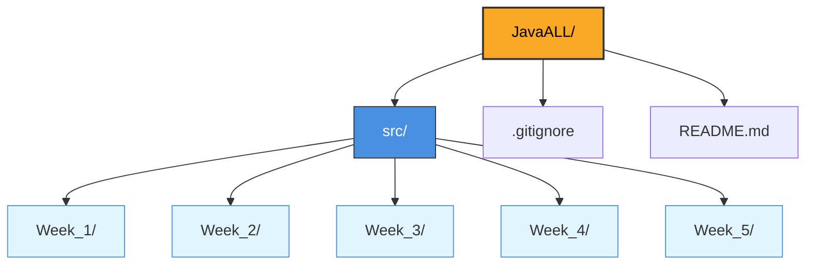

# My Programming Journey in Java

A personal repository documenting my journey of learning and programming in Java.

This repository contains weekly practice programs, coding exercises, experiments, and implementations of various Java concepts.

## Repository Structure

## Tools & Technologies

# ☕ JavaALL

> All my Java practice — Week 1 to Week 5, in one repo.

---

### 🛠️ Tech Stack

| Tool | Details |
| :--- | :--- |
| **Language:** |  |
| **IDE:** |  |
| **JDK:** | |
| **Version Control:** |   |

---

## Purpose

The goal of this repository is to document my progress, practise Java programming, understand core concepts, and maintain a collection of working implementations.

Programs are written, tested, and updated as I progress through the topics.

##  Notes

- This is a personal learning repository.
- Code is continuously evolving.
- Some implementations are experimental or intended for practice.
- Improvements and corrections are part of the learning process.

---
